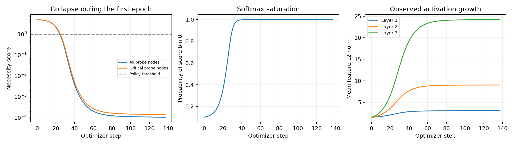
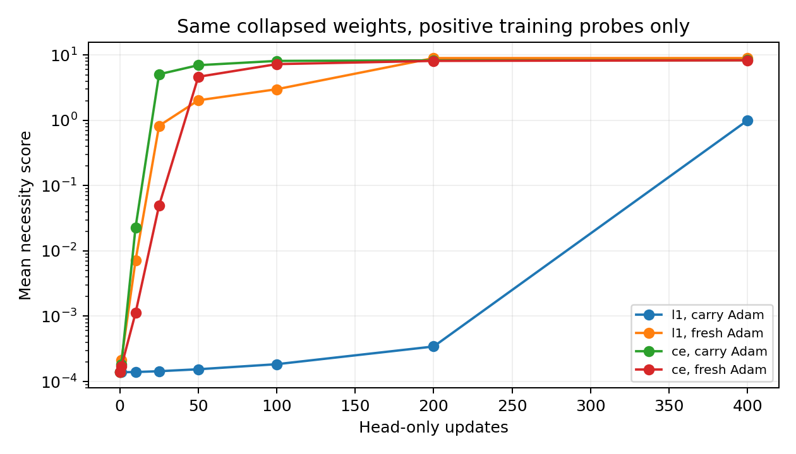
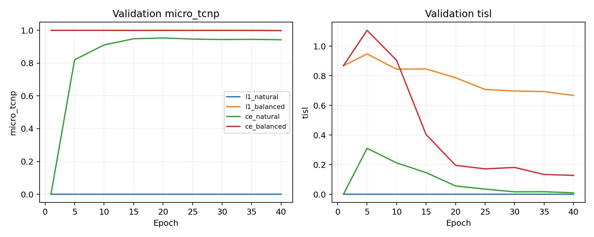

# 27 任务塌缩机制：受控实验与全量单因素对照

日期：2026-11-02（Asia/Shanghai）。**新证据支持：公开训练配方中，零标签主导的 L1 信号、softmax 期望分数的饱和和 Adam 历史状态共同形成优化退化。保持 27 任务、旧编码及完整训练配置，只换成 CI 加权交叉熵即可恢复有效保留。** 这是本地受控诊断，不能反推出作者实际使用了什么配方。

## 官方有训练好的模型吗，我们跑过吗

截至本次查询，官方 GitHub HEAD 仍为 `456c60b6fd47941d1e5849db573dbbcb488e3ae7`，仓库树只有代码/README，Releases 和 Issues 列表为空；作者链接的 Hugging Face 数据仓库没有模型权重文件，数据发布账号的公开模型列表也为空。因此，**在这些官方公开入口没有找到作者训练好的 checkpoint，也没有运行过作者原权重**。此前运行的是官方模型结构在本地重新训练的权重；不能把二者混称。

来源：[官方仓库](https://github.com/yyyyhx/MINIM)、[Releases](https://github.com/yyyyhx/MINIM/releases)、[数据仓库](https://huggingface.co/datasets/Chaoyu112358/MINIM-data/tree/main)。查询端点、文件列表和返回结果保存在 `results/causal27_20261102/official_checkpoint_search.json`。此结论限定于已检查的公开入口，不声称作者没有未公开或其他渠道的权重。

## 1. 故障在第一轮已经发生

冻结官方原始 GATv2 与 CI-L1，hidden=256、batch=32、lr=3e-4、seed=0，按原 27 任务训练划分和顺序重跑第一轮。137 次更新平均 loss=2.1818109，吻合原训练日志第一轮 2.1818；逐 batch 追踪未使用验证或测试标签。

三张来自不同域、含关键节点的训练探针图，初始必要性均值为 5.0019。第 **26 次更新**时，探针图上的关键节点已全部被移除。到第一轮末，必要性均值为 0.000105、0 分类别概率均值为 0.999910。这不是第十轮检查点保存或测试脚本才引入的问题。

探针第三层特征范数从 1.565 增至 24.241。这与饱和同时发生；本轮没有单独干预归一化层，故不把范数增长单独认定为唯一触发原因。

## 2. 解析梯度与 autograd 一致，方向被零标签主导

第一批敏感度零标签有 24160 个，其对全体预测统一平移的 loss 导数贡献为 +0.9665；必要性零标签有 21657 个，贡献为 +0.8868。必要性高分节点只有 702 个，反向贡献为 -0.0284。正导数表示梯度下降会把分数压低。

对 softmax 期望分数 `y_hat=sum(k*p_k)`，L1 的 logits 梯度为：

`dL/dz_j = w * sign(y_hat-y) * p_j * (j-y_hat) / N`

当分布集中在某个错误类别时，`p_j*(j-y_hat)` 也会趋近零，即使真实标签与预测相差很大。类别 0 不是唯一可能的退化顶点；单测中类别 9 高置信预测标签 7，误差依然约 2，L1 梯度已极小。

CI-CE 的梯度则为 `w*(p_j-1[j=y])/N`。错分时仍有纠正梯度。137 批中，解析的头部 bias 梯度与 autograd 最大差异仅 5.96e-08；没有发现这部分反向传播实现错算。CE 同时改变了统计目标和类别监督方式，本轮不能把其全部收益只归因于其中一项。

## 3. 同数据、同编码、同初始化的 2×2 对照

从原训练集固定选择 15 棵基础树（每域 5 棵），每个树-任务只取 balanced persona，共 135 个变体、125,112 个节点；验证仍为原 27 任务的全部 592 个变体。四组均使用旧任务哈希、256 hidden、seed=0、batch=4、40 epochs、lr=3e-4、固定阈值 1/5，不使用唯一任务编码或先验校正。

两因素仅为损失 L1/CE 和是否做训练集逆频率类别平衡；所有组保留相同 CI 风险权重、按节点求均值，不用每个 batch 的权重和重新归一化。下表为末轮验证指标，不以最佳中间轮替换失败末轮，也没有查看测试集：

| 组别 | 真实关键节点保留率 | 真实关键交互保留率 | TISL |
|---|---:|---:|---:|
| l1_natural | 0.0000 | 0.0000 | 0.0000 |
| l1_balanced | 0.9986 | 0.9986 | 0.6677 |
| ce_natural | 0.9424 | 0.9414 | 0.0100 |
| ce_balanced | 0.9986 | 0.9989 | 0.1278 |

原始 L1 全移除；平衡 L1 可防止归零但泄漏高；**无类别平衡的 CI-CE 已能恢复有效折中**。因此，不必同时更改任务编码、类别平衡和先验校正才能解除这个失败案例。这里“不做类别平衡”不表示取消 CI 权重。

## 4. Adam 状态是额外因素，饱和并非不可逆

使用同一第一轮末塌缩权重，冻结骨干，只在 32 个来自训练探针的关键节点上更新必要性头 400 步。所有标签≥7，人为移除了零标签竞争，分别保留或重置 Adam 状态：

| 头部训练目标 | Adam 状态 | 最终平均必要性 | MAE |
|---|---|---:|---:|
| l1 | carry | 1.0000 | 7.4062 |
| l1 | fresh | 8.9931 | 1.5322 |
| ce | carry | 8.3418 | 1.4755 |
| ce | fresh | 8.3092 | 1.4827 |

重置 Adam 后，L1 也能把分数从约 0 拉高；保留旧状态则恢复困难。因此，之前单凭梯度很小推断“模型无法恢复”不充分。旧 Adam 的历史矩估计与当前小梯度一起影响更新。旧状态 L1 的均值约 1，处于策略阈值边界，其少量保留不能当成可靠恢复。

这不是验证/测试成绩：探针全是正样本，骨干被冻结。它只证明优化器状态具有因果影响，不证明在原始分布上重置 Adam 就能修好模型。

## 5. 全量实验进一步只改变训练目标

为去除小子集、batch 和训练轮次的混淆，再按原 27 任务完整配方训练一次：4,356 train、592 val、452 test；hidden=256、原生 batch=32、10 epochs、相同 seed/lr/weight decay、相同旧编码、相同划分和末轮检查点。程序核对配置，除输出目录外，**唯一变化是 `ci_l1 → ci_ce`**。没有类别平衡、唯一任务编号或先验校正。

| 完整训练目标 | 测试真实保留率 | 测试真实交互保留率 | 测试 TCNP / TCNP-I | TISL |
|---|---:|---:|---:|---:|
| 官方 CI-L1 | 0 | 0 | 0.035398 / 0.035398 | 0 |
| 实验性 CI-CE | 0.995559 | 0.995475 | 0.993767 / 0.993754 | 0.037915 |

测试只在预定第十轮训练完成后评估，没有据测试重新选轮次或阈值。独立冻结模型推理与官方 Table 1 脚本核对一致，另保存 Table 4。该实验说明替换目标足以解除当前公开数据与实现组合下的退化，**不等于复现了论文宣称的原始 L1 配方，也不能断定作者实际用了 CE**。

测试敏感节点识别召回率为 48.35%，高敏且关键节点的 Abstract 召回率为 37.07%。高保留率和低 TISL 只覆盖本基准定义的效用与任务无关泄漏，不能解释为全部敏感内容均已正确抽象；本轮也没有执行真实代理任务的成功率评测。

## 6. 其他解释与边界

- 27 任务已经核验；此前确认的额外阅读任务碰撞不再是这个失败的必要条件。
- 原数据与缓存 5,400 条标签已全量比对。进一步检查 1350 个树-任务组的四个 persona，标签数组均相同，没有发现同组相互矛盾的 persona 标注。
- 同一特征、图结构和模型用 CI-CE 可学习，支持输入中确有可用信号；这不等于排除了所有局部特征缺陷。
- 仅一个种子；小实验只用 15 棵训练树。全量单因素对照增强了证据，但未穷尽多任务梯度冲突、初始化或归一化的贡献。
- 原始配置在稀疏数据上退化的观察可重复；为什么作者论文得到另一组数值，仍需要作者实际 checkpoint、训练配置及原始 split 才能交叉核验。

## 复查入口

- 脚本：`scripts/causal27_diagnostics.py --stage trace/factorial`，`scripts/report_causal27.py --evaluate-full`。
- 最小非官方替代选项：主训练器增加 `--loss_type ci_ce`；默认仍为 `ci_l1`，旧检查点和既有配置保留。CI-CE 对标签要求为 0–10 的整数，拒绝静默截断分数。
- 原始 trace / 梯度 / 恢复 / 对照表在 `results/causal27_20261102/`，配置和诊断权重在 `runs/causal27_20261102/`。
- 全量 CI-CE 权重：`runs/causal27_20261102/full_ci_ce/model.pt`；新旧配置与权重哈希在 `full_loss_only_comparison.json`。
- 数学梯度与 CLI 目标一致性、错类别饱和、非整数拒绝等新增测试在 `tests/test_causal27_diagnostics.py`。

