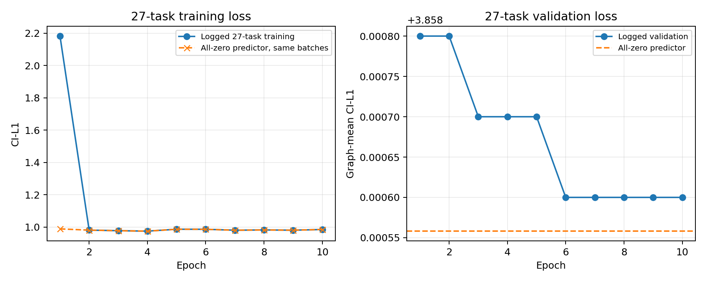

# 27 任务清洗版独立复核

> 后续（2026-11-02）：[塌缩机制与单因素对照](MINIM_27任务塌缩机制实验.md)已完成。原始 CI-L1 的失败记录保留；同完整数据只替换 CI-CE 后恢复有效保留，并通过逐步梯度追踪和 Adam 状态干预进一步定位原因。这不是作者原始 checkpoint 的结果。

日期：2026-10-31（Asia/Shanghai）。**结论：27 任务版本的官方配置重跑仍发生近零分数塌缩。去掉额外阅读任务后，全移除现象没有解除。**

## 本轮实际执行范围

收到重试请求后，发现另一条本地进程已经完成 `runs/paper_aligned/` 的 10 轮训练并正在运行官方评估。因此没有再启动相同配置的重复训练。本轮独立完成了全部原始标签/缓存核验、冻结官方模型加载和全测试集推理；没有修改该进程的检查点、阈值或结果文件。

## 数据与配置

- 清洗数据：`data_paper_aligned/manifest.jsonl`，确为 **27 种任务、5,400 个变体、5,048,216 个节点**。仅移除 350 个 `T_` 阅读变体，保留的 JSON 树仍指向原始物理文件，标签没有重新标注。
- Train / val / test：4,356 / 592 / 452 个变体，基础树为 120 / 15 / 15；无交集，且与清洗前划分使用同一批基础树。这次改变的是任务集合，不是另挑一批测试页面。
- GATv2 hidden=256、4 heads、10 epochs、**原生 batch=32（未使用梯度累积）**、AdamW、lr=3e-4、weight decay=1e-5、seed=0、alpha=lambda=1。
- 原始 CI-L1、旧任务编码，三个额外 boost=0；没有使用唯一编码、平衡 CE 或先验校正。与论文一致的训练设置沿用，不能把本轮称为修复版训练。
- 全部 5,400 条缓存标签与原 JSON 逐项相等。独立测试使用单独缓存目录，只链接已验证、输入未变的 452 条测试特征，不混用被删除任务。未重新计算全部 MiniLM 嵌入。

## 独立测试结果

使用固定官方提交的原始 GATv2 类严格加载本次权重，对全部 452 个测试变体重新计算：

| 项目 | 实测 |
|---|---:|
| 测试节点 | 645,528 |
| Keep / Abstract / Remove | 0 / 0 / 645528 |
| 关键节点保留 | 0 / 17112 |
| 关键交互节点保留 | 0 / 16796 |
| 官方 TCNP / TCNP-I | 0.035398 / 0.035398 |
| 真实节点微平均保留率 | 0.000000 |
| TISL（阈值 1） | 0.000000 |

TCNP/TCNP-I 的 3.54% 来自 16 个没有关键节点/关键交互节点的变体默认得分为 1，`16/452=0.035398`；实际保留率为零。独立计算与官方 Table 1 CSV 吻合到其六位小数。

整个测试集必要性分数均值约 1.09e-05，最大值 0.000418342，远低于阈值 1；敏感度最大值 0.000541363，也远低于阈值 5。

## 阈值选择并未解决退化

另一进程的验证集扫描（`results/paper_aligned/selected_threshold.json`）选择 `tau_nec=0`。由本轮全部测试分数的范围可知，这会使所有节点变成 Keep：TCNP/TCNP-I/TISL 均为 1。阈值 1 全移除，阈值 0 全保留，两者都未恢复有效折中；不能把全保留的 100% 保留率当成复现成功。

## 失败机制更新

1. **任务数量和已发现的阅读任务碰撞不是本次失败的充分解释。** 27 任务数据仍塌缩。原生 batch=32 也出现同样现象，说明该现象不要求使用此前的梯度累积。
2. **不是清洗后缓存标签未更新。** 全量 5,400 条逐项核验通过，输入树仅通过软链接复用。
3. **训练目标的零预测退化仍是重点。** 清洗数据敏感度为零占 96.88%，必要性为零占 86.36%。恒定零预测器的验证损失为 3.858558132，与末轮日志 3.8586 吻合到日志精度；末轮训练损失 0.9854 也与按同批次重算的 0.985405567 吻合。

这些证据支持原始 L1/softmax 期望分数训练仍退化到接近零的解释，但没有证明这是唯一原因。任务数已核对，不应继续把 34/27 差异当作本次失败的主要解释。若继续定位，下一项受控实验应固定这份 27 任务数据、划分和旧任务编码，只比较训练目标；这属于单独诊断配置，不冒称官方配方。

## 可复查文件

- 独立脚本：`scripts/audit_clean27_run.py`。
- 原始核验与计数：`results/clean27_audit/audit.json`；全零对照：`results/clean27_audit/training_zero_comparison.csv`。
- 训练日志：`logs/train_paper_aligned.log`；独立核验日志：`logs/clean27_independent_audit.log`。
- 数据 manifest SHA256：`cd1946e2761683b8fff5961fb97d47605b0e45e0a381784620e2b9d393be4d10`。
- 检查点 SHA256：`ae98bae6ff436387e0736ed12286238cd669c78225b51e5f3c7dc180658e8e86`，独立推理前后未变。
- 冻结官方源码 SHA256：`96eeb211078b721fb6848e88b0bb87f44f9067c83d5143c415c6326602a5dcd6`。

