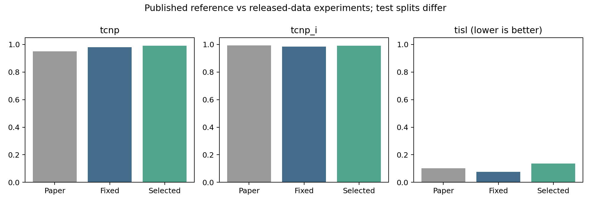

# MINIM 参考性能对齐实验

日期：2026-11-04。使用 run-experiment 技能在既有 RTX 3060 Laptop GPU 环境实际训练。此次采用完整公开数据，不覆盖历史失败对照或已有修复模型。

| 结果来源 | TCNP | TCNP-I | TISL↓ |
|---|---:|---:|---:|
| Paper (different split) | 0.949100 | 0.993100 | 0.101000 |
| New, fixed 1/5 | 0.980167 | 0.985172 | 0.075128 |
| New, validation policy | 0.989940 | 0.991106 | 0.136738 |

固定官方阈值相对论文参考的差值为：TCNP +3.11 个百分点，TCNP-I -0.79 个百分点，TISL -0.02587。验证所选策略在测试上没有保持预期泄漏预算：0.136738 高于论文参考的 0.101，表明阈值校准存在泛化差距。因此两套结果同时展示，未按测试重新调参，也不将校准策略描述为全面优于固定策略。

论文来自 Table 1：[官方论文](https://proceedings.mlr.press/v306/yu26bq.html)。论文测试集为 662，本地测试集为 484，不能把分差直接解释成方法优劣或严格复现。

模型仍为 512 维输入、三层 GATv2、hidden256、4 heads、595990 可训练参数。完整训练集 4637，验证集 629，测试集 484；保持原基础树划分 120/15/15，无交集。AdamW、lr=3e-4、weight decay=1e-5、batch32、10 epochs、seed0；使用末轮 checkpoint。

主动修改两项：CI-L1 改为 CI 加权交叉熵，旧任务哈希改为训练集固定唯一编号。未做类别平衡或推理先验校正。MiniLM 和原始节点标签沿用已核验的官方发布版本。

验证集扫描 55 组全局阈值。先最大化相对论文保留目标的最小达成度（超过目标封顶），再惩罚超出论文的泄漏；同分优先更低泄漏，再优先接近官方阈值。这避免为贴合论文数值而故意降低已有保留率或提高泄漏。选中 tau_nec=0.25、tau_sens=7。决定在测试推理之前写入 selected_policy.json；测试未参与训练、阈值或检查点选择。

测试真实节点微平均保留率为 0.991748，真实交互节点微平均保留率为 0.996270，与表中按变体聚合的 TCNP 分开记录。固定官方阈值 1/5 的结果也完整保留，避免只展示校准结果。

所选策略下，敏感节点检测召回率为 32.60%，高敏且关键节点的 Abstract 召回率为 27.65%。TISL 只计算任务无关敏感内容的 token 代理，因此不能将低 TISL 解读为所有敏感字段都被正确抽象。

官方 Table 1 与独立数组计算均对所选及固定策略核对，误差小于 1e-6。保留官方指标文件、标签和原始失败产物；全部分数来自实际推理。单种子、替代损失和不同数据版本限制了结论；没有执行真实浏览器代理任务成功率评测。

checkpoint SHA256：`7758d688aca56bf89d6a74a691d659b8455f9dd174f53f1883dfb8ab26c34542`。

复跑：`bash scripts/run_reference_profile.sh`。已有完整 checkpoint 时校验配置并重新评估；缺失时按记录训练。入口：[运行脚本](../scripts/run_reference_profile.sh)、[评估与选策略](../scripts/evaluate_reference_profile.py)、[预先保存的协议](../scripts/reference_profile_protocol.json)。

产物：`runs/reference_profile_20261104/model.pt`、`selected_policy.json`、`results/reference_profile_20261104/summary.json`、`validation_sweep.csv`、`validation_scores.npz`、`test_scores.npz`；所选策略的 6 项 Table/Figure 在 selected/，固定阈值 Table 1 在 fixed_1_5/。Figure 2 的测试阈值曲线仅作描述，不用于重新选择阈值。

