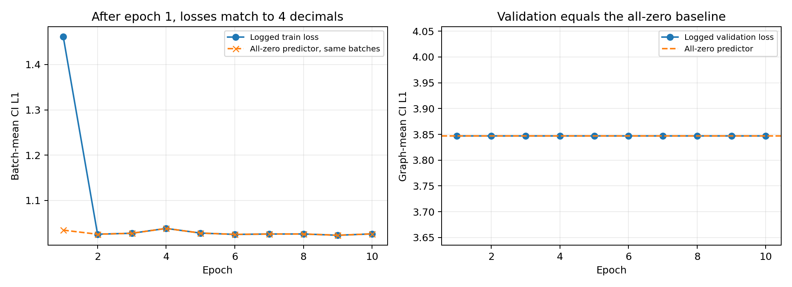

# MINIM 复现结果与失败原因诊断

> 最新复核：[官方设置对齐与扩大训练结果](MINIM_对齐与扩大训练结果.md)已补做 hidden=256、有效 batch=32、10 epochs 的全量官方原始模型/损失对照，仍全移除。修复版 6/15/30 树扩展另行保存；原数据版本与论文划分仍未完全对应。

> 后续工作已完成：[小规模修复与验证报告](MINIM_小规模修复报告.md)。唯一任务编码、平衡 CE 和先验校正已解除全移除塌缩；`(2,2,1)` 单独启用的小规模对照仍塌缩。以下保留原失败检查点的诊断证据。

检查日期：2026-10-31（Asia/Shanghai）。对象：现有 `runs/minim/model.pt`、固定 `split.json`、全量结果与日志，以及官方论文和当前公开实现。

**结论：本次训练发生了接近全零的分数塌缩，最终策略在整个测试集上等价于“全部移除”。工程运行完成，但核心论文结果未复现。最有证据的失败机制是零标签主导的 L1 优化与 softmax 输出饱和共同作用；另确认任务编码存在哈希碰撞，损失了区分部分任务所必需的信息。** 尚未做完整训练对照，不能把所有差距归因于一个参数。

## 1. 结果重新核验

本次直接加载原检查点，对全部 484 个测试变体、696,266 个节点重新推理，并独立计算全移除、随机预算和使用真实标签的 Oracle 对照。原权重和原实验表未覆盖。

| 策略 | TCNP（官方宏平均） | TCNP-I（官方宏平均） | TISL | 实际关键节点保留率（微平均） |
|---|---:|---:|---:|---:|
| 论文 MINIM | 0.9491 | 0.9931 | 0.1010 | 论文未单列 |
| 本次检查点 | 0.033058 | 0.039256 | 0 | **0** |
| 独立全移除对照 | 0.033058 | 0.039256 | 0 | **0** |
| 独立随机预算对照 | 0.228383 | 0.234629 | 0.197124 | 0.201794 |
| 真实标签 Oracle | 1 | 1 | 0 | 1 |

实测动作：Keep=0，Abstract=0，Remove=696,266。19,510 个关键节点全部被删除，其中 17,695 个关键交互节点也全部被删除。

TCNP 的 3.31% **不代表保住了 3.31% 的关键节点**。`evaluate_metrics.py:63–81` 对没有关键节点的变体返回 1，然后做变体宏平均；测试中恰有 16 个这样的变体，`16/484=0.03305785`。没有关键交互节点的变体有 19 个，`19/484=0.03925620`。因此当前两个非零保留指标完全由分母为空时的约定产生。Gmail 的 13.56% 也等于 `16/118`，不能解释成该域实际保留了关键内容。

TISL=0 来源于全部删除。Table 4 三种策略相同，是因为 Abstract 从未触发；当前消融不能支持抽象策略有效。Oracle 只是验证标签到策略、指标这段链路可以产生高分，不是可部署模型，也不保证任务实际执行成功。

## 2. 最有证据的训练失败机制

### 2.1 零标签主导了 L1 目标

重新读取全部特征缓存的标签，得到：

| 划分 | 变体数 | 节点数 | 敏感度=0 | 必要性=0 | 必要性≥7 |
|---|---:|---:|---:|---:|---:|
| Train | 4,637 | 4,256,881 | 96.9044% | 85.8866% | 2.9446% |
| Val | 629 | 486,971 | 95.4862% | 85.0357% | 3.3318% |
| Test | 484 | 696,266 | 98.0584% | 86.9656% | 2.8021% |

当前目标是敏感度 L1 加 CI 加权必要性 L1，三个额外 boost 实际均为 0。L1 的最优常数预测是标签的中位数；在训练集上，敏感度中位数和 CI 加权必要性中位数均为 0。这说明模型早期向零收缩有明显的目标函数激励，**不等于证明一个充分利用特征的模型只能输出零**。

为核验日志是否真的显示学习进展，按原 seed=0、batch size=16 和每轮原始 shuffle 顺序，计算了“不训练、始终预测零”的损失：

| Epoch | 日志训练损失 | 全零预测器按同批次重算 |
|---|---:|---:|
| 1 | 1.4615 | 1.034181668 |
| 2 | 1.0252 | 1.025156986 |
| 3 | 1.0273 | 1.027273467 |
| 4 | 1.0380 | 1.037972436 |
| 5 | 1.0277 | 1.027680913 |
| 6 | 1.0248 | 1.024827805 |
| 7 | 1.0256 | 1.025564499 |
| 8 | 1.0257 | 1.025666755 |
| 9 | 1.0229 | 1.022875930 |
| 10 | 1.0259 | 1.025942746 |

**第 2–10 轮全部吻合到日志四位小数。** 全零预测器的验证损失为 **3.846814546**，也吻合每轮日志 3.8468。后九轮的训练损失波动可以由批次组成变化完整解释，不能视作持续学习的证据。每轮模型未保存，故不能逐节点还原早期预测，但上述等价性和最终检查点的输出高度一致。

训练在每个 batch 内按节点求均值，验证则先对每张图求损失再平均，权重口径不同。全零模型的训练集节点平均损失是 0.972981、图平均是 3.129261；验证集对应为 1.150251 和 3.846815。因此“train≈1、val≈3.85”不能直接作为过拟合结论。

### 2.2 softmax 期望分数已经饱和

代码 `train_minim_scorer.py:121–128` 正确按 `sum(softmax(logits) * score_bins)` 计算期望分数，没有遗漏 0–10 分值转换。

全测试集预测：

| 分数 | 最小值 | 均值 | 最大值 | 策略阈值 |
|---|---:|---:|---:|---:|
| 敏感度 | 4.95e-12 | 1.63e-8 | 4.23e-6 | 5 |
| 必要性 | 4.34e-9 | 1.21e-6 | 1.17e-4 | 1 |

即使最有必要的预测也比阈值低约 8,500 倍。只在原来 0.5–10 的范围扫阈值，无法修复这种输出。

在三个域各选一张含正标签的训练图，保持权重不变，比较同一 logits 上的 L1 期望分数梯度与整数标签交叉熵梯度。两个头的 0 分类别平均概率为 0.9999886–1.0；正标签节点上的 L1 logits 梯度约为交叉熵的 `1.94e-8–1.50e-5`，相差约 **6.7 万至 5,100 万倍**。

这直接证明当前检查点已处于很弱的 L1 恢复梯度区间，支持“向零收缩后饱和”的机制解释。梯度比较不等于交叉熵训练的性能对照，也不证明 Adam 绝不可能恢复。

不建议直接打开全部 boost：`nec_low_boost` 加大低必要性标签权重，可能进一步强化向零偏置。函数签名中的默认值 `(2,2,1)` 被 CLI 显式传入的 `(0,0,0)` 覆盖，这是公开代码的行为；目前没有证据表明把签名默认值全部打开就能复现论文。

## 3. 已确认的任务编码缺陷

GAT 的任务条件只来自 `stable_hash(goal_id) % 32` 对应的一位特征，见 `train_minim_scorer.py:265`。另行构造的 128 桶 `goal_ids` 没有传入 GAT 分支。34 种任务实际只占用了 21 个桶；所有测试任务在训练中都出现过，因此当前问题不是测试出现了未知任务。

对每个域的一棵训练树检查全部变体，直接对 **512 维节点特征与完整边张量的字节内容**做哈希，确认以下成对输入完全相同，但目标标签不同：

| 域/训练树 | 被混淆的任务 | 必要性标签不同的节点 | 关键节点身份不同的节点 |
|---|---|---:|---:|
| Gmail / task_35 | extract_2fa_code / T_read_body | 13 / 78 | 4 |
| Gmail / task_35 | reply_slack / T_identify_sender | 9 / 78 | 3 |
| Reddit / task_10 | vote_content / T_read_post | 280 / 1,362 | 101 |
| Shopping / task_166 | add_to_wishlist / T_read_price | 39 / 673 | 24 |

确定性模型无法对完全相同的输入输出不同分数。这是实证确认的信息损失，直接妨碍任务必要性学习。它不能单独解释全部节点都归零，但应在后续重训前修正；仅扩大模型或延长训练无法恢复没有输入的信息。该检查覆盖三棵训练树，未将冲突比例外推至整个数据集。

后续范围核对：四对冲突均涉及公开版的 `T_` 阅读任务；原 27 种非 `T_` 任务在各域内部没有检测到任务哈希碰撞。这一结论针对当前公开 34 任务数据，不能直接外推为论文原来的 27 任务实验也存在相同冲突，详见 [官方对齐清单](MINIM_官方对齐清单.md)。

## 4. 论文与公开实现未完全对齐

重新阅读[官方论文 PDF](https://raw.githubusercontent.com/mlresearch/v306/main/assets/yu26bq/yu26bq.pdf)，与本地代码和数据对照：

| 项目 | 论文 | 公开实现 / 本次运行 |
|---|---|---|
| GAT hidden | 附录 B.2 为 256 | 官方默认和本次均为 496 |
| Batch size | 32 | 16，按此前显存适配要求选择 |
| 总变体 / 任务种类 | 5,403 / 27 | 5,750 / 34 |
| 数据划分 | 文中 4,741 train + 662 test | 4,637 train + 629 val + 484 test |
| 测试域计数 | Gmail/Reddit/Shopping=472/130/60 | 118/156/210 |
| 必要性标签取值 | 正文描述 {0,5,10} | 实测 {0,2,4,6,7,8,10} |

这些差异说明本次完成的是公开版本的训练评估流程，尚不能称为论文实验设置的严格复现。hidden=496 是此前执行要求和[公开训练器](https://raw.githubusercontent.com/yyyyhx/MINIM/456c60b6fd47941d1e5849db573dbbcb488e3ae7/train_minim_scorer.py)的值，不能算本地任意改动；也没有实验支持 hidden 差异是全零塌缩的主因。

随机预算三项结果确实能从本地测试集重新算出，并非本地脚本硬编码。但它不依赖训练权重，其吻合不能验证监督训练成功或证明使用了论文同一划分。论文声明 662 个测试变体，而本地 484 个仍得到吻合至六位的小数，原始 split 和数据版本的对应关系需要作者提供才能解释。

## 5. 本次没有发现支持的其他解释

- 原训练日志完整结束于第 10 轮，权重能严格加载，没有训练中断或 OOM 导致缺失后续轮次的证据；显存紧张不等于本次结果失败的已证实原因。
- train/val/test 按 `(domain, sample_id)` 两两检查，交集均为 0，未发现同一基础样本跨划分。
- 三个域各抽查一个缓存的标签与原 JSON，一致，特征有限且文本嵌入范数正常。另从三个域各取一图，在 CPU 重新生成全部特征，与缓存最大差异仅 `1.79e-7–2.59e-7`，标签、边和其他张量完全相同。抽查不替代全量缓存校验，但没有支持“缓存改坏特征是主因”的证据。
- 原数据完整性检查记录了 5,440,118 个节点，无缺失或越界标签；本次没有发现将缺失标签普遍填成零的证据。
- 目前只有单 seed、15 棵基础测试树；484 个变体不能视为 484 个独立基础场景。不能声称已有统计显著的论文反证。

## 6. 后续实验优先级

1. **先恢复小规模可学习性。** 固定覆盖三域、有关键节点和敏感节点的训练子集，做可过拟合检查；逐步记录两个头的正负类损失、梯度、分数分位数和 K/A/R。比较原 L1、类别平衡 L1、基于现有 11 类输出的交叉熵/序数目标，明确区分复现配置与修改后的诊断配置。采样及权重只从训练集确定。
2. **消除任务输入碰撞。** 对有限任务集用稳定的唯一编码，或明确加入任务文本语义；增加“同树不同任务”的成对检查。把该改动与损失改动分别做对照。
3. **校准复现条件。** 保留现有 496 维失败基线，另按论文 256 维配置建立独立运行；确认原始 split、数据提交和标注版本。若用梯度累积模拟 batch 32，图大小不同须按节点数加权，不能直接等权平均两个 micro-batch 的 loss。
4. **通过验证集选择有效模型。** 同时报官方宏平均、排除空分母的宏平均、节点微平均，以及每个策略动作覆盖率；选择检查点时加入效用要求并记录早期 batch。当前第一轮验证就已退化，仅增加末尾早停或继续十轮不构成解决方案。
5. **有有效 Abstract 覆盖后再做消融。** 固定测试集，至少多 seed 运行，并按基础树而非变体评估不确定性。测试集不参与阈值和方法选择。

## 7. 证据与复查入口

- 主诊断：`results/diagnosis/audit.json`，含全测试预测统计、动作计数、四种策略、标签分布、梯度检查。
- 逐图标签统计：`results/diagnosis/per_graph.csv`。
- 全零训练损失复算：`results/diagnosis/zero_baseline_training.json`。
- 完全相同输入的标签冲突：`results/diagnosis/input_conflicts.json`。
- 三域缓存重新计算：`results/diagnosis/cache_recompute.json`；过程日志 `logs/diagnose_cache.log`。
- 主诊断脚本：`scripts/diagnose_reproduction.py`；运行 `OMP_NUM_THREADS=2 MKL_NUM_THREADS=2 .venv/bin/python -u scripts/diagnose_reproduction.py`，输出至独立目录；日志 `logs/diagnose_reproduction.log`。

本轮完成结果审查和机制诊断，没有做完整重训或宣称修复成功。原训练器、检查点与正式结果表保持原样；后续应优先验证训练目标与任务编码，再投入全量计算。
