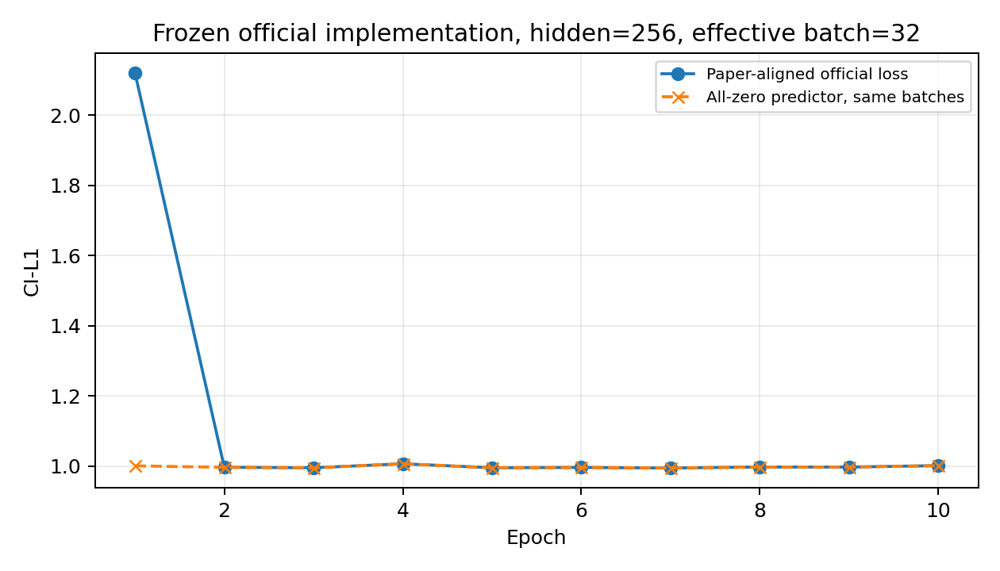
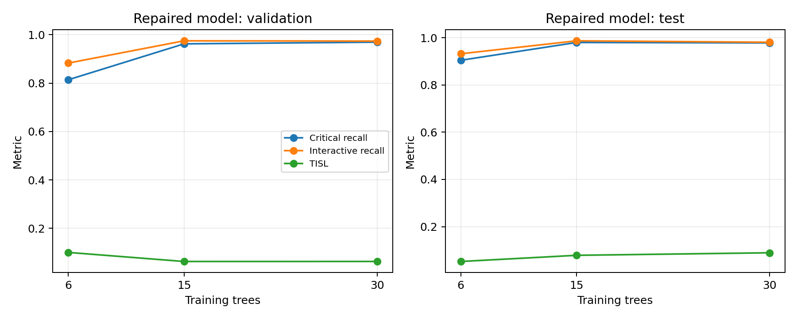

# MINIM 官方设置对齐与训练规模实验结果

执行日期：2026-10-31（Asia/Shanghai）。先运行冻结官方实现的论文设置对照，再单独扩大修复版数据。两者的训练目标不同，不混称官方复现。

## 官方究竟写了什么

论文附录 B 给出：三层 GATv2、hidden=256、4 heads、512 维输入、AdamW、lr=3e-4、weight decay=1e-5、batch=32、10 epochs、alpha=lambda=1；正文公式采用 CI 加权 L1。正文另说明必要性阈值用验证集选择，最终为 1，敏感度阈值为 5。

但公开代码默认 hidden=496；公开数据为 5,750 个变体，按代码划分得到 4,637/629/484，而论文写 5,403 个变体、4,741 train 与 662 test。已提供的官方代码提交未包含原始 split 或可直接核验论文指标的检查点。因此可以对齐明确的设置，不能自行声称重建了论文原始数据划分。

唯一任务编码、平衡 CE、先验校正是前一轮为诊断失败新增的实验改动，不是官方配方。6/15/30 棵树也是本地扩展实验，官方原实验本来使用完整训练集。

数据线索：公开版含 7 种 `T_` 阅读任务、350 个变体；排除后为 5,400，仍不等于论文 5,403。原 27 种非 `T_` 任务在各域内没有检测到任务哈希碰撞；之前四对实证同树冲突均涉及新增阅读任务。因此，当前版本的编码问题不能直接外推为论文原实验也存在该冲突。

来源：[论文 PDF](https://raw.githubusercontent.com/mlresearch/v306/main/assets/yu26bq/yu26bq.pdf)，[官方固定版本训练器](https://raw.githubusercontent.com/yyyyhx/MINIM/456c60b6fd47941d1e5849db573dbbcb488e3ae7/train_minim_scorer.py)。逐项设置见 [对齐清单](MINIM_官方对齐清单.md)。

## 按论文设置的官方对照

直接实例化官方提交原始模型，调用原始损失；hidden=256、有效 batch=32、10 epochs；旧任务哈希、CI-L1、无额外 boost、无 CE、无先验校正。训练为全部 120 棵树、4,637 个变体，验证 629，测试 484。按照官方行为使用末轮检查点，另保存全部 10 个 epoch 供核验。

micro-batch=4 的梯度乘以其节点数占完整 batch 的比例，再累积到 32 张图后更新。不同大小图的整批梯度等价性测试通过。磁盘缓存仅作硬件适配。源码 SHA256：`96eeb211078b721fb6848e88b0bb87f44f9067c83d5143c415c6326602a5dcd6`。

实测测试指标：TCNP=0.033058，TCNP-I=0.039256，TISL=0.000000；真实关键节点保留率=0.000000，真实关键交互节点保留率=0.000000，Remove=100.00%。

这项结果检验了模型宽度和 batch 对齐是否足以恢复效果；它仍受公开数据版本与论文划分未对齐的限制。日志与每轮权重保存在 `runs/training_scale/official_paper_full/`，全零损失对照在 `results/training_scale/official_zero_baseline.csv`。

## 修复版扩大训练

训练集合按基础树逐级包含，每域 2/5/10 棵，共 6/15/30 棵；训练变体数为 68/170/340。仅保留 balanced 和 reading 变体。各规模使用相同的唯一任务编码、平衡 CE、先验校正、hidden=256、seed=0、batch=4、40 epochs、固定阈值 1/5。

统一验证集来自原 val 的全部 15 棵基础树，过滤重复 persona 后为 185 个变体。按验证集 `micro TCNP - 0.5*TISL` 选择检查点和训练规模；所有选择完成后，才在同一原测试集 484 个变体、696,266 个节点上评估。上一轮只有 34 个测试变体，其 65.06% 不与这里的数字直接相减。

| 训练树 | 训练变体 | 所选 epoch | 验证：真实保留率 / TISL | 测试：真实保留率 / 真实交互保留率 / TISL |
|---|---:|---:|---:|---:|
| 6 | 68 | 38 | 0.8139 / 0.1005 | 0.9045 / 0.9320 / 0.0524 |
| 15 | 170 | 40 | 0.9623 / 0.0630 | 0.9799 / 0.9869 / 0.0786 |
| 30 | 340 | 19 | 0.9693 / 0.0631 | 0.9781 / 0.9808 / 0.0893 |

仅按验证集选出 `repair_30`。与本轮相同测试集上的 6 树基线相比，其真实保留率变化为 +7.36 个百分点，TISL 变化为 +0.0369；泄漏相对变化为 +70.38%。三组的完整曲线和每个节点类别的识别指标均保留在原始 JSON/CSV 中。

这次测试中，15 树的真实保留率和交互保留率略高于 30 树，TISL 也低于 30 树。说明从 6 树扩大到 15 树已有明显效用收益，继续扩大并未单调改善；不因测试结果而推翻事先按验证选择的 30 树模型。TISL 相比 6 树上升，不能表述为所有指标同时改善。下一步应对 15/30 树做多种子确认，而不是直接假定更多数据必然更好。

所选模型敏感节点识别召回率为 44.60%，高敏且关键节点的 Abstract 召回率为 28.48%。即使关键节点保留率已高，也不能据此声称所有隐私策略行为都已复现。这里是修复方法在公开测试集上的结果，不是原论文训练配方数值的成功复现。

注意：固定 epochs 意味着更多数据也带来更多优化更新；本实验不能把收益单独归因于数据覆盖。只有一个种子、一个嵌套子集序列，不报告显著性，也不据测试表现重新选模型。官方 TISL 的短文本占位符代理未修改，仍可能出现 Abstract 比 Keep 的代理值更高。

## 所选修复版的 Abstract 消融

同一检查点、同一 484 变体测试集，使用官方 Table 4 脚本：

| 策略 | TCNP | TCNP-I | TISL |
|---|---:|---:|---:|
| Adaptive | 0.958498 | 0.961708 | 0.089289 |
| Abs->Rm | 0.886369 | 0.908049 | 0.074888 |
| Abs->Kp | 0.958498 | 0.961708 | 0.098101 |

本轮 A→R 会损失关键内容与交互保留，A→K 则提高泄漏代理，支持所选修复模型中 Abstract 的效用。该结论限于当前公开数据和修复配置；官方指标仍存在短文本占位符长度的代理偏差。

## 文件与复跑

- 训练器：`scripts/run_training_scale.py`；`--mode official` 为论文设置的官方对照，`--mode repair --trees 6/15/30` 为单独的修复扩展。
- 完整复跑：`bash scripts/run_training_scale_study.sh`；已经完成的训练会跳过，选模决定在测试前保存。两条路径的官方 Table 1 与独立评估作一致性检查，所选修复版另输出 Table 4。
- 结果表：`results/training_scale/comparison.csv`；选模记录：`results/training_scale/selection.json`；全量统计：`results/training_scale/summary.json`。
- 官方对照权重：`runs/training_scale/official_paper_full/model.pt`；按验证选择的修复权重：`runs/training_scale/repair_30/model.pt`。
- 各规模 split/config/history/summary 均在独立运行目录。原失败权重 SHA256 未变，四组测试集完全一致，三组修复验证集一致，训练树集合逐级包含，均由分析脚本断言校验。
- 五项回归检查通过，包含节点数不等时的梯度累积等价性；两条路径的官方 Table 1 与独立指标核对一致。

