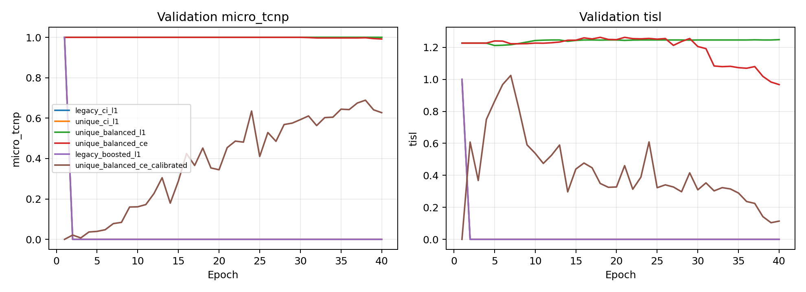
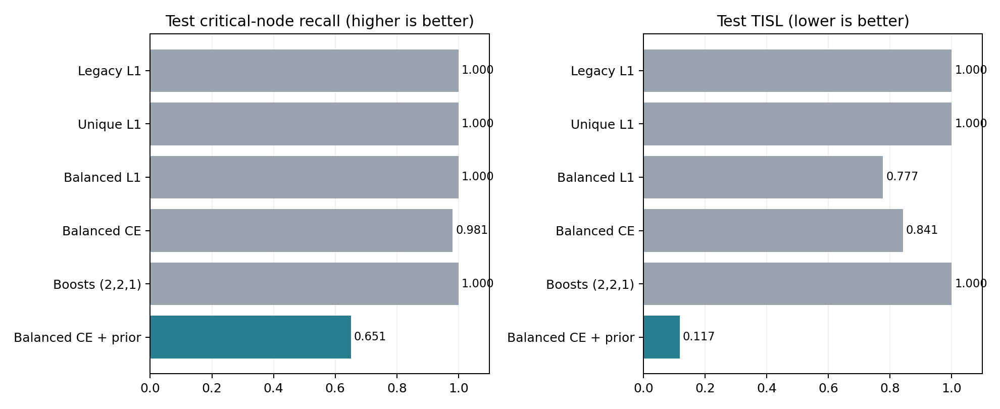

# MINIM 小规模修复与验证报告

> 后续：[官方设置对齐与扩大训练结果](MINIM_对齐与扩大训练结果.md)已完成。这份报告保留第一轮 34 变体小测试的历史记录；后续 484 变体测试结果不与此处数字直接相减。

执行日期：2026-10-31（Asia/Shanghai）。状态：代码修复、六组小规模训练、验证集选择、独立小测试集评估、官方六个评估脚本及清洗推理均完成。**模型已解除全移除塌缩，但尚未达到论文效用水平。**

## 修复内容

1. 任务条件改为训练集确定的唯一编号。34 个任务不再压缩到 32 个哈希桶。编号映射写入检查点，推理和所有评估脚本自动恢复；未知任务明确报错。已对之前发现的四对真实碰撞输入检查，修复后全部可区分。
2. 保留原始 CI-L1，新增平衡 L1 与平衡交叉熵。类别权重仅用训练集计数拟合，已观察类别的权重为 `N / (有效类别数 × 类别计数)`；必要性继续使用 CI 权重。每个头按当前批次权重和归一化。
3. 平衡 CE 会改变类别分布，直接对其 softmax 求期望会推高分数。额外对照在推理 logits 上减去 `log(训练类别权重)`，抵消这部分分布偏移；训练从未出现的类别屏蔽。该校正不参与梯度更新，不使用验证/测试标签估计先验。
4. 原始特征缓存继续保存旧布局，唯一任务特征在读取后替换；原检查点和原正式结果表保留。新选项默认关闭，旧运行可以继续按原配置复查。

## 实验协议

- 公开数据不变。训练用三域各 2 棵树，68 个变体、86,122 个节点；验证用各 1 棵树，34 个变体、25,288 个节点；测试用各 1 棵树，34 个变体、18,690 个节点。三个集合的基础树两两不重叠，分别来自原 train/val/test。
- 每个任务保留 balanced 标注变体与 reading 变体，避免同任务四种 persona 的重复副本；这属于诊断子集，不代表全量数据分布。
- 三层 GATv2、hidden=256、4 heads、512 维输入；seed=0、batch=4、AdamW、lr=3e-4、weight decay=1e-5，每组 40 epochs。各组相同初始权重和批次顺序。CUDA 图聚合仍可能带来数值非确定性。
- 所有策略阈值固定 necessity=1、sensitivity=5。仅以 `验证集真实关键节点保留率 - 0.5 × 验证集 TISL` 选择检查点与方法，平分保留更早轮次。先完成全部选择，再运行小测试集；未根据测试结果改参数。
- 后补的 `(2,2,1)` 和先验校正对照仍使用同一子集和协议。只有一个随机种子，测试仅 3 棵基础树，不能据此声称统计显著或完成论文复现。

## 六组实测结果

下表保留验证集选出的检查点，保留率均为节点微平均，排除了空关键集合的默认满分影响。

| 配置 | 所选 epoch | 验证：真实保留率 / TISL | 测试：真实保留率 / TISL |
|---|---:|---:|---:|
| legacy_ci_l1 | 1 | 1.0000 / 1.0000 | 1.0000 / 1.0000 |
| unique_ci_l1 | 1 | 1.0000 / 1.0000 | 1.0000 / 1.0000 |
| unique_balanced_l1 | 5 | 1.0000 / 1.2116 | 1.0000 / 0.7768 |
| unique_balanced_ce | 40 | 0.9919 / 0.9673 | 0.9807 / 0.8415 |
| legacy_boosted_l1 | 1 | 1.0000 / 1.0000 | 1.0000 / 1.0000 |
| unique_balanced_ce_calibrated | 38 | 0.6890 / 0.1420 | 0.6506 / 0.1173 |

**本次原始 L1、唯一编码 L1、`(2,2,1)` 加权 L1 在第 5 轮时均已退化为全移除。** 表中三个配置显示 100% 保留，是因为验证选择保留了第 1 轮的“全保留”检查点，同时 TISL=1；不能将其当成有效方法。`(2,2,1)` 在本次受控小规模对照中不足以单独解决失败，尚未做该配置的全量重训。

平衡 L1 和未经先验校正的 CE 恢复了非零分数，但隐私效用折中仍差。验证集最终选择 `unique_balanced_ce_calibrated` 的第 38 轮。验证集真实保留率为 68.90%，TISL=0.1420。

## 所选修复版的独立小测试结果

| 指标 | 实测 |
|---|---:|
| 官方 TCNP（变体宏平均） | 0.753257 |
| 官方 TCNP-I（变体宏平均） | 0.870380 |
| 真实关键节点保留率（微平均） | 0.650579 |
| 真实关键交互节点保留率（微平均） | 0.737662 |
| TISL | 0.117312 |
| 敏感节点识别 precision / recall | 0.8201 / 0.5359 |
| 高敏且关键节点的 Abstract 召回率 | 0.0988 |
| Keep / Abstract / Remove 节点数 | 4387 / 230 / 14073 |

相对完整观察，官方泄漏代理下降 88.27%。相对原失败检查点的真实保留率 0%，现为 65.06%，提升 65.06 个百分点；零基线不计算相对倍数。共有 518 个关键节点，保留 337 个；385 个关键交互节点，保留 284 个。

**限制：仍删除约 35% 的关键节点，不能作为已达到论文水平或可直接部署的隐私过滤器。** 高敏关键节点 Abstract 召回率也偏低，后续需要增加训练树覆盖并检查任务条件学习。工程修复与小规模有效学习已验证，泛化与论文数值复现仍待完成。

## Abstract 消融与指标异常

官方脚本实测 Adaptive 的 TCNP/TISL=0.753257/0.117312；A→R 为 0.692332/0.067528，删除抽象节点会损失效用。A→K 为 0.753257/0.089399，泄漏代理反而更低，不能据此声称当前消融完整支持 Abstract 的隐私优势。

原因是官方公式 `tok_post(A)=max(6, 0.05*tok)` 对不足 6 token 的节点可能高于原文本长度。本测试有 44 个敏感且无关的 Abstract 节点属于此情形。仅作为诊断，将该代理上限截为原 token 数得到 TISL=0.089399；**未修改官方指标或用辅助指标挑模型**。后续应单独审计占位符代理与真实清洗文本的对应关系。

## 验证与复查

- 四项回归测试通过：真实碰撞形式可区分且文本/结构保留、未知任务拒绝、饱和 logits 下 CE 恢复梯度、先验校正不抬高缺失类别。
- 主训练 CLI 的 unique + balanced CE + prior correction 已完成一轮 GPU 集成检查；该一轮仅验证接口，不计入方法表现。
- 所选权重重新加载后指标一致；Table 1/3/4/10、Figure 2/3 和全 34 变体清洗推理通过。清洗输出的删除和三个文本字段抽象行为与动作一致。
- `results/pilot_fix/verification.json` 记录数据隔离、旧权重 SHA256、四对真实输入修复、动作计数和官方表一致性检查。

复跑小规模六组训练与验证选择：`bash scripts/run_small_scale_fix.sh`。完整结果在 `runs/pilot_fix/summary.json`，日志为 `logs/pilot_fix_train.log`、`logs/pilot_fix_extra_train.log`、`logs/pilot_fix_test.log`。所选检查点：`runs/pilot_fix/unique_balanced_ce_calibrated/model.pt`。

